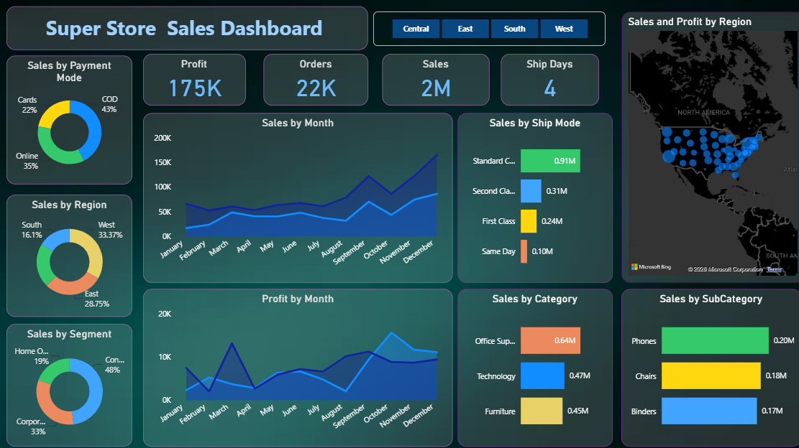

# Power BI Dashboards

A collection of interactive Power BI dashboards built for data analysis and business reporting. Each project has its own folder with the dashboard file (`.pbix`), dataset, screenshots and a detailed README.

## Projects

| Dashboard | Description | Preview |
|-----------|-------------|---------|
| [Super Store Sales](./super-store-sales-dashboard) | Sales, profit, region, category, shipping and payment analysis of a US retail store (2019–2020) |  |

## Tools

- Power BI Desktop
- Power Query
- DAX

## How to Use

1. Open the folder of the dashboard you are interested in.
2. Download the `.pbix` file.
3. Open it with [Power BI Desktop](https://powerbi.microsoft.com/desktop/).

## Contact

GitHub: [munavvar-karimova](https://github.com/munavvar-karimova)
