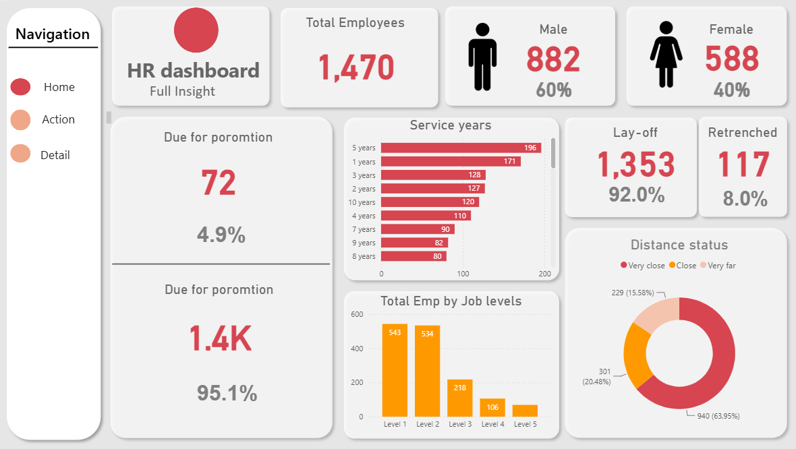
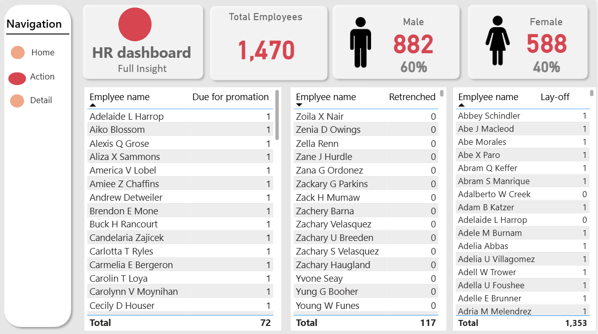
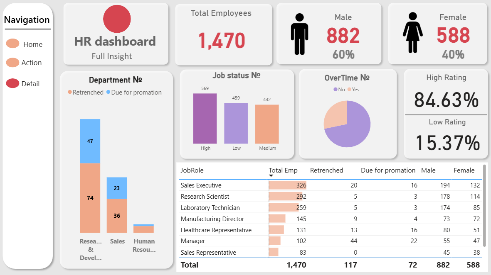

# HR Analytics Dashboard

An interactive Power BI dashboard that gives a full overview of the workforce: headcount, gender split, tenure, job levels, commuting distance, attrition (retrenchment), promotion eligibility, overtime and performance rating.

## Preview

**Page 1 – Home (Overview)**



**Page 2 – Action (Employee Lists)**



**Page 3 – Detail (Department & Job Role Analysis)**



## Objective

Help HR managers quickly understand:
- How big the workforce is and how it is split by gender
- How many employees are due for promotion and how many have been retrenched
- Which departments and job roles are most affected
- How tenure, job level, commuting distance and overtime are distributed

## Key Metrics (KPI cards)

| Metric | Value | Description |
|--------|-------|-------------|
| Total Employees | 1,470 | Total headcount |
| Male / Female | 882 (60%) / 588 (40%) | Gender distribution |
| Due for promotion | 72 (4.9%) | Employees eligible for promotion |
| Not due for promotion | ~1.4K (95.1%) | All other employees |
| Retrenched | 117 (8.0%) | Employees who left through retrenchment |
| Remaining employees | 1,353 (92.0%) | Employees not retrenched |
| High / Low Rating | 84.63% / 15.37% | Share of high and low performance ratings |

## Dashboard Contents

### Page 1 – Home
- Navigation menu (Home, Action, Detail) with page navigation buttons
- KPI cards: total employees, male, female, due for promotion, retrenched
- **Service years** (bar chart)
- **Total employees by job level** (column chart, Level 1–5)
- **Distance status** (donut): Very close, Close, Very far

### Page 2 – Action
- Employee-level tables for quick action:
  - Employees **due for promotion**
  - **Retrenched** employees
  - Employees by lay-off / status flag
- Sorted and scrollable lists with totals

### Page 3 – Detail
- **Department analysis** (stacked column): retrenched vs. due for promotion
- **Job status** (column chart): High, Medium, Low
- **Overtime** (pie chart): Yes / No
- **High / Low rating** cards
- **Job role table** with total employees, retrenched, due for promotion, male and female counts

## Highlights

- The workforce is 60% male and 40% female.
- Levels 1 and 2 together make up about three quarters of all employees.
- The most common tenure is 5 years (196 employees), followed by 1 year (171).
- About 64% of employees live very close to the workplace; only about 16% live very far.
- Research & Development has the highest number of retrenched employees (74).
- Sales Executive is the largest job role (326 employees).
- The Manager role has the highest retrenchment count (44 out of 102).

## Tools & Techniques

- **Power BI Desktop**
- Power Query for data cleaning and preparation
- DAX measures (headcount, gender %, retrenched %, promotion eligibility)
- Page navigation with buttons and bookmarks
- Visuals: KPI cards, bar, column, stacked column, donut, pie charts and tables

## Files

```
hr-analytics-dashboard/
├── README.md
├── HR_Analytics_Dashboard.pbix
├── screenshot-1.png
├── screenshot-2.png
└── screenshot-3.png
```

## How to Use

1. Download the `.pbix` file.
2. Open it in [Power BI Desktop](https://powerbi.microsoft.com/desktop/).
3. Use the navigation menu on the left to switch between pages.
