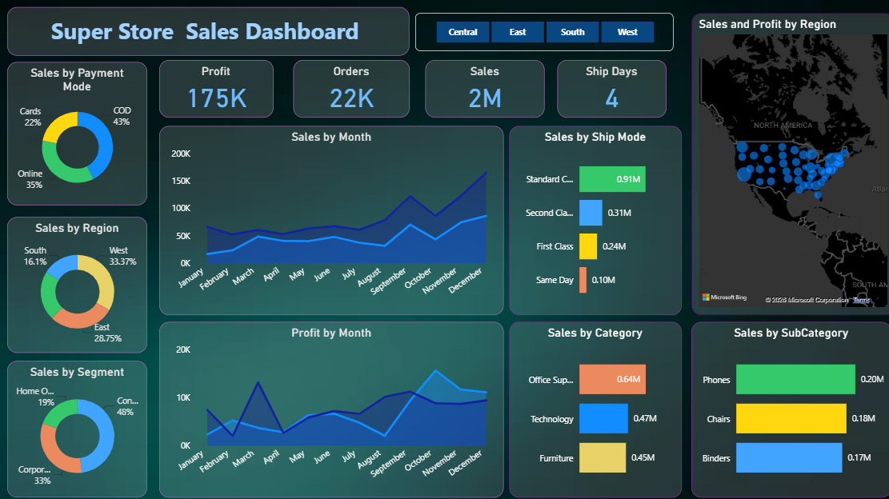
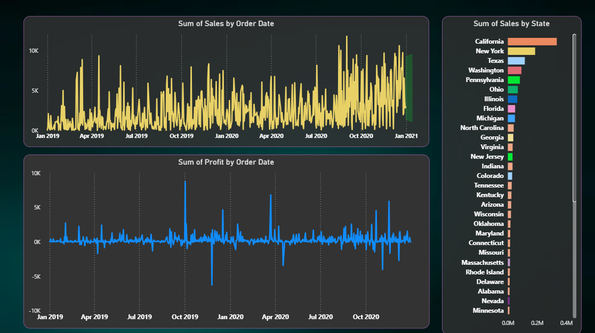

# Super Store Sales Dashboard

An interactive Power BI dashboard analyzing sales performance of a US retail store (Super Store) across regions, product categories, customer segments, shipping modes and payment methods.

## Preview

**Page 1 – Overview**



**Page 2 – Sales Trend & State Analysis**



## Objective

Give management a quick, filterable view of:
- How much the store sells and earns (Sales, Profit, Orders)
- Which regions, categories and products drive revenue
- How sales and profit change month by month
- Which shipping and payment methods customers prefer
- Which US states generate the most sales

## Dataset

- **File:** `SuperStore_Sales_Dataset.csv`
- **Size:** 5,901 rows, 23 columns
- **Period:** January 2019 – December 2020
- **Key fields:** Order Date, Ship Date, Ship Mode, Segment, State, Region, Category, Sub-Category, Sales, Quantity, Profit, Payment Mode

## Key Metrics (KPI cards)

| Metric | Value | Description |
|--------|-------|-------------|
| Sales | ~1.57M | Total sales amount |
| Profit | ~175K | Total profit |
| Orders | ~22K | Total quantity of items ordered |
| Ship Days | ~4 | Average days between order and shipping |

## Dashboard Contents

### Page 1 – Overview
- **Region slicer** (Central, East, South, West) filters the whole page
- **Sales by Payment Mode** (donut): COD, Online, Cards
- **Sales by Region** (donut)
- **Sales by Segment** (donut): Consumer, Corporate, Home Office
- **Sales by Month** and **Profit by Month** (area/line charts)
- **Sales by Ship Mode** (bar): Standard, Second, First Class, Same Day
- **Sales by Category** and **Sales by Sub-Category** (bar)
- **Sales and Profit by Region** (map)

### Page 2 – Sales Trend & State Analysis
- **Sales by Order Date** (daily time series with forecast)
- **Profit by Order Date** (daily time series, shows profit spikes and loss days)
- **Sales by State** (ranked bar chart)

## Highlights

- Standard Class is the most used shipping mode (~0.91M in sales).
- Office Supplies is the top category, followed by Technology and Furniture.
- The West region has the largest share of sales (~33%).
- California and New York are the top states by sales.
- Sales and profit trend upward toward the end of the year.

## Tools & Techniques

- **Power BI Desktop**
- Power Query for data cleaning and preparation
- DAX measures (Total Sales, Total Profit, Total Quantity, Average Ship Days)
- Visuals: slicers, KPI cards, donut, area, line, bar and map charts
- Custom dark theme with rounded containers and background image

## Files

```
super-store-sales-dashboard/
├── README.md
├── SuperStore_Sales_Dataset.csv
├── Super_Store_Sales_Dashboard.pbix
├── screenshot-1.png
└── screenshot-2.png
```

## How to Use

1. Download the `.pbix` file.
2. Open it in [Power BI Desktop](https://powerbi.microsoft.com/desktop/).
3. If prompted, update the data source path to the location of the CSV file.
